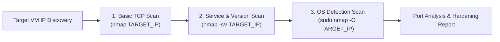

# Oasis Infobyte Cyber Security Internship
## Task 1: Basic Network Scanning with Nmap


---

### Table of Contents
1. [Internship Task & Objective](#internship-task--objective)
2. [What is Nmap?](#what-is-nmap)
3. [Why Network Scanning Matters](#why-network-scanning-matters)
4. [Tools & Lab Environment](#tools--lab-environment)
5. [Nmap Installation Guide](#nmap-installation-guide)
6. [Locating the Target Virtual Machine IP](#locating-the-target-virtual-machine-ip)
7. [Nmap Scanning Methodology & Commands](#nmap-scanning-methodology--commands)
   - [1. Basic TCP Port Scan](#1-basic-tcp-port-scan)
   - [2. Service & Version Detection Scan](#2-service--version-detection-scan)
   - [3. Operating System (OS) Detection Scan](#3-operating-system-os-detection-scan)
8. [Saving and Managing Scan Outputs](#saving-and-managing-scan-outputs)
9. [Open Port & Service Analysis Guide](#open-port--service-analysis-guide)
10. [Security Considerations & Hardening](#security-considerations--hardening)
11. [Scan Verification & Screenshots](#scan-verification--screenshots)
12. [Ethical Use & Legal Guidelines](#ethical-use--legal-guidelines)
13. [Conclusion & Key Takeaways](#conclusion--key-takeaways)
14. [Official Documentation & References](#official-documentation--references)

---

### Internship Task & Objective

- **Internship Organization**: Oasis Infobyte (OIBSIP)
- **Internship Track**: Cyber Security
- **Project Domain**: Network Reconnaissance & Vulnerability Assessment
- **Task Identifier**: Task 1 (Level 1)
- **Task Title**: Basic Network Scanning with Nmap

#### Core Objective
The primary objective of this task is to perform an authorized, controlled network scan of an isolated local target virtual machine (VM), discover active services and open ports, attempt remote operating-system identification, analyze security risks associated with uncovered services, and prepare comprehensive technical documentation for evaluation.

---

### What is Nmap?

**Nmap** (short for *Network Mapper*) is an open-source, industry-standard command-line utility used for network discovery, host detection, port enumeration, service identification, and vulnerability auditing. Created by Gordon Lyon (Fyodor) in 1997, Nmap operates by transmitting crafted raw network packets (such as TCP SYN, TCP Connect, UDP, and ICMP echo probes) to the target host and analyzing the responses or lack thereof.

Nmap can determine:
- Whether a remote host is alive and responding.
- Which network ports are `open`, `closed`, or `filtered` (blocked by a firewall).
- What applications, services, and exact software versions are running on open ports.
- What operating system and kernel version the remote machine is likely running.
- What firewall rules, packet filters, or defense mechanisms are active.

---

### Why Network Scanning Matters

In modern cybersecurity and penetration testing workflows, network scanning represents the **Reconnaissance and Enumeration** phase of the ethical hacking lifecycle:

1. **Attack Surface Discovery**: Every open network port is an entry point into an operating system. Knowing which ports are exposed allows security analysts to map the organization's perimeter and internal exposure.
2. **Asset and Inventory Auditing**: System administrators use network scanners to verify that only authorized software runs on production machines, preventing rogue servers or forgotten services from remaining exposed.
3. **Vulnerability Identification**: Outdated service versions often contain known Public Vulnerabilities and Exposures (CVEs). Discovering exact software builds allows administrators to prioritize patching before an adversary can exploit them.
4. **Configuration Validation**: Network scans verify that host-based firewalls (like `ufw` or `iptables`) and network segmentation rules are functioning as intended.

---

### Tools & Lab Environment

| Component | Tool / Environment | Description / Role |
| :--- | :--- | :--- |
| **Scanner Machine** | Kali Linux / Ubuntu Linux | Dedicated penetration testing Linux distribution containing Nmap. |
| **Target Machine** | Authorized Local VM (e.g., Ubuntu Server, Metasploitable 2) | Local virtual machine running inside VirtualBox or VMware Workstation. |
| **Network Adapter** | Host-Only / NAT Network | Isolated private virtual network ensuring no packets leave the local lab. |
| **Port Scanner** | Nmap (v7.90+) | CLI network exploration tool. |
| **Screen Recorder** | OBS Studio / SimpleScreenRecorder | Video capture software for creating the internship evaluation demo. |
| **Version Control** | Git & GitHub | Workspace repository management and task submission. |

> [!IMPORTANT]
> **Strict Lab Isolation Requirement**: All activities in this project must take place within an isolated virtual lab environment. Testing against production systems, public websites, or external IP addresses without authorization is strictly prohibited.

---

### Nmap Installation Guide

#### 1. On Kali Linux
Nmap comes pre-installed on Kali Linux. If it needs to be installed or updated, run:
```bash
sudo apt update
sudo apt install nmap -y
```

#### 2. On Ubuntu / Debian Linux
```bash
sudo apt update
sudo apt install nmap -y
```

#### 3. Verification
Verify that Nmap is installed properly and check the version:
```bash
nmap --version
```

---

### Locating the Target Virtual Machine IP

Before launching any scan, you must determine the private IP address assigned to your authorized target VM.

#### Step 1: Open Terminal on the Target VM
Log into your target virtual machine (Ubuntu or Metasploitable) and run one of the following commands:
```bash
ip addr show
# or
ip a
# or (on older systems)
ifconfig
```

#### Step 2: Identify the Active Interface IP
Look for an interface such as `eth0`, `enp0s3`, or `ens33`. Locate the `inet` line:
```text
inet 192.168.56.101/24 brd 192.168.56.255 scope global dynamic eth0
```
In this example, the target IP is `192.168.56.101`.

#### Step 3: Verify Network Connectivity from the Scanner
From your Kali Linux scanner terminal, test reachability using ICMP:
```bash
ping -c 3 TARGET_IP
```
*(Replace `TARGET_IP` with your actual target IP, e.g., `ping -c 3 192.168.56.101`)*

If packets are received with 0% packet loss, your lab network is properly connected and ready for scanning.

---

### Nmap Scanning Methodology & Commands

We execute three progressive scans to build a detailed security profile of the target host.



---

#### 1. Basic TCP Port Scan
Scans the 1,000 most common TCP ports on the target host to determine open communication channels.

```bash
nmap TARGET_IP -oN basic_scan.txt
```

- **Command Syntax Explanation**:
  - `nmap`: Invokes the network mapper executable.
  - `TARGET_IP`: The IPv4 address of the target machine.
  - `-oN basic_scan.txt`: Directs Nmap to save standard human-readable output to the specified file.
- **Behind the Scenes**:
  - When executed as a regular user, Nmap performs a **TCP Connect Scan (`-sT`)**, completing the standard 3-way handshake (`SYN` -> `SYN/ACK` -> `ACK`).
  - When executed as root or with `sudo`, Nmap defaults to a **TCP SYN "Stealth" Scan (`-sS`)**, sending a `SYN` packet and resetting the connection (`RST`) upon receiving `SYN/ACK` to minimize socket overhead.

---

#### 2. Service & Version Detection Scan
Probes active ports to determine what software application and version number is listening.

```bash
nmap -sV TARGET_IP -oN service_scan.txt
```

- **Command Syntax Explanation**:
  - `-sV`: Enables **Service Version Detection**.
  - `-oN service_scan.txt`: Saves the service enumeration report.
- **Behind the Scenes**:
  - Nmap queries its internal database (`nmap-service-probes`).
  - It sends protocol-specific request probes to each open port and compares the response strings, banners, and error messages against thousands of signatures to identify the application (e.g., `OpenSSH 8.2p1`, `Apache httpd 2.4.41`).

---

#### 3. Operating System (OS) Detection Scan
Analyzes low-level TCP/IP stack behavior to identify the remote operating system.

```bash
sudo nmap -O TARGET_IP -oN os_scan.txt
```

- **Command Syntax Explanation**:
  - `sudo`: Required because OS fingerprinting crafts raw network packets and inspects low-level header flags.
  - `-O`: Enables **Remote Operating System Detection**.
  - `-oN os_scan.txt`: Saves the operating system detection output.
- **Behind the Scenes**:
  - Different operating system kernels implement RFC networking standards with subtle differences in Initial Sequence Number (ISN) generation, TCP options order, IP ID sampling, and window size behavior.
  - Nmap fires a battery of up to 16 probes (TCP, UDP, ICMP) and matches the observed fingerprint against its `nmap-os-db` signature library.

---

### Saving and Managing Scan Outputs

Nmap supports multiple output formats. In this project, we prioritize `-oN` for clear evaluation, but professionals frequently combine them:

| Flag | Format Name | Description |
| :--- | :--- | :--- |
| `-oN <file>` | **Normal** | Human-readable text format matching standard terminal output. |
| `-oX <file>` | **XML** | Structured XML output suitable for automated parsers and vulnerability scanners. |
| `-oG <file>` | **Grepable** | Line-oriented output easily parsed with `grep`, `awk`, and `cut`. |
| `-oA <prefix>` | **All Formats** | Generates `.nmap`, `.xml`, and `.gnmap` files simultaneously using the given prefix. |

---

### Open Port & Service Analysis Guide

Understanding what an open port implies is fundamental to cyber security. **An open port is not inherently a vulnerability**; it is an active listening socket intended for communication. Risk arises from insecure protocols, default configurations, or outdated software containing known vulnerabilities.

| Common Port / Protocol | Service Name | Intended Purpose | Primary Security Consideration | Recommended Mitigation |
| :---: | :---: | :--- | :--- | :--- |
| **21 / TCP** | **FTP** | File Transfer Protocol | Transmits credentials and data in plaintext; vulnerable to sniffing and anonymous login misconfigurations. | Migrate to SFTP (over SSH) or FTPS (TLS); disable anonymous authentication. |
| **22 / TCP** | **SSH** | Secure Shell | Secure remote administration and encrypted command execution. | High exposure to automated brute-force attacks; weak passwords or deprecated ciphers. | Enforce key-based authentication; disable root login; implement `fail2ban`; change default port if exposed. |
| **23 / TCP** | **Telnet** | Legacy Remote Terminal | Unencrypted interactive command-line access. | Transmits passwords and commands in cleartext over the wire. | **Disable immediately**. Replace completely with SSH. |
| **53 / UDP & TCP** | **DNS** | Domain Name System | Resolves hostnames to IP addresses. | DNS cache poisoning, open recursion (amplification attacks), unauthorized zone transfers (`AXFR`). | Disable open recursion on internal servers; restrict zone transfers to trusted secondaries; implement DNSSEC. |
| **80 / TCP** | **HTTP** | Hypertext Transfer Protocol | Unencrypted web traffic delivery. | Cleartext transmission of session cookies, form submissions, and login credentials. | Enforce HTTPS (TLS 1.3); deploy HTTP Strict Transport Security (HSTS); redirect all port 80 traffic to 443. |
| **443 / TCP** | **HTTPS** | HTTP Secure (TLS/SSL) | Encrypted web traffic delivery. | Weak SSL/TLS ciphers (e.g., TLS 1.0/1.1), expired certificates, web application vulnerabilities (SQLi, XSS). | Enforce TLS 1.2+ only; use strong cipher suites; maintain valid SSL certificates; audit web application code. |
| **445 / TCP** | **SMB** | Server Message Block | Network file sharing and printer sharing in Windows/Samba environments. | Historically targeted by worm exploits (e.g., EternalBlue / WannaCry); SMB relay attacks. | Disable SMBv1; enforce SMB signing and encryption; block port 445 at border firewalls; patch immediately. |
| **3306 / TCP** | **MySQL** | Relational Database Management | Internal database queries for applications. | Direct external exposure invites brute force attacks, credential stuffing, and data exfiltration. | Bind service to `127.0.0.1` (localhost only); never expose directly to untrusted networks; use strong passwords. |

---

### Security Considerations & Hardening

Following network enumeration, defensive security engineers apply the following remediation principles:

1. **Attack Surface Minimization (Principle of Least Privilege)**:
   - Shut down and disable every service and daemon that is not strictly required for operations (`sudo systemctl disable --now <service>`).
2. **Host-Based Packet Filtering**:
   - Enable host firewalls (`ufw` on Ubuntu, `iptables`, or Windows Defender Firewall) to drop unsolicited inbound connections on non-public ports.
3. **Banner Hiding / Scrambling**:
   - Prevent scanners from easily discovering exact patch levels by suppressing version banners in service configuration files (e.g., `ServerTokens Prod` in Apache, `expose_php = Off` in PHP).
4. **Regular Vulnerability Patching**:
   - Consistently apply security updates to all daemon packages (`sudo apt update && sudo apt upgrade -y`).

---

### Scan Verification & Screenshots

To substantiate task completion, screenshots must be captured directly from your scanner terminal during scan execution and saved in the `screenshots/` directory:

#### 1. Basic Port Scan Terminal Output

*Figure 1: Terminal output displaying execution of `nmap TARGET_IP -oN basic_scan.txt` showing open ports.*

#### 2. Service & Version Detection Scan

*Figure 2: Terminal output displaying execution of `nmap -sV TARGET_IP -oN service_scan.txt` identifying software versions.*

#### 3. Operating System Detection Scan

*Figure 3: Terminal output displaying execution of `sudo nmap -O TARGET_IP -oN os_scan.txt` showing OS fingerprinting.*

---

### Ethical Use & Legal Guidelines

Network scanning tools like Nmap are dual-use technologies: they are essential tools for defense, but can be misused for malicious reconnaissance.

> [!CAUTION]
> **Legal Warning**: Scanning networks without explicit, written authorization from the owner is illegal in most jurisdictions under computer crime laws, including the **Indian Information Technology Act, 2000 (Section 43 & 66)**, the **US Computer Fraud and Abuse Act (CFAA)**, and the **UK Computer Misuse Act**.
> 
> - **Always obtain written authorization** before initiating scans on any network you do not own.
> - **Never scan public IP addresses, college or university Wi-Fi networks, or public domains.**
> - **Confine educational exercises** strictly to private virtual environments configured with RFC 1918 non-routable address space (e.g., `10.0.0.0/8`, `172.16.0.0/12`, `192.168.0.0/16`).

---

### Conclusion & Key Takeaways

Through this task, we demonstrated:
- How Nmap identifies accessible TCP ports on a networked system.
- How application signatures and banner grabbing allow analysts to enumerate software versions.
- How differences in TCP/IP protocol implementations allow remote OS identification.
- Why proactive reconnaissance is the foundation of network hardening and defensive security posture management.

---

### Official Documentation & References

1. [Official Nmap Reference Guide (Man Page)](https://nmap.org/book/man.html)
2. [Nmap Service and Application Version Detection Documentation](https://nmap.org/book/vscan.html)
3. [Nmap Remote OS Detection Methodology](https://nmap.org/book/osdetect.html)
4. [Gordon Lyon, "Nmap Network Scanning: The Official Nmap Project Guide to Network Discovery and Vulnerability Scanning"](https://nmap.org/book/)
5. [OASIS INFOBYTE Internship Portal](https://oasisinfobyte.com/)
